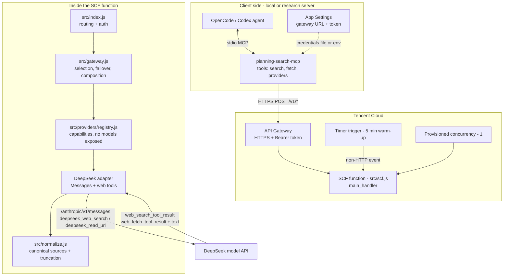
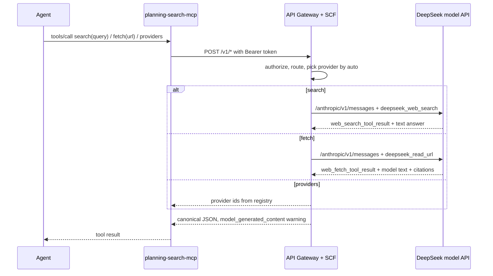

# yooooo-search-gateway

A provider-agnostic HTTP search gateway for the `planning-search-mcp` client. Provider adapters, provider keys, failover, quotas and response normalization live here. The gateway exposes three stable HTTP methods (`search`, `fetch`, `provider`); the MCP client wraps them as `search`, `fetch` and `providers` tools.

## Design invariant

Provider differences stop at this service. The client never sees vendor-specific tool names, headers, model ids or response fields. Adding a backend means adding an adapter and a secret here; no app rebuild, agent config change or prompt change is needed. See `docs/SOLUTION_SEARCH_MCP.md` in the main project for the full architecture.

## Architecture



- The MCP client owns only the gateway URL and token; all provider keys stay in SCF environment variables.
- `search` and `fetch` go through model-native web tools on the provider, never standalone Search & Fetch REST endpoints.
- Responses are normalized into one canonical shape; provider identity comes from `/v1/provider` and powers the MCP `providers` tool.



## HTTP API

All endpoints answer JSON. All `/v1/*` endpoints require `Authorization: Bearer <GATEWAY_TOKEN>`.

| Method | Path | Body | Response |
| --- | --- | --- | --- |
| `GET` | `/health` | — | `{ "ok": true, "providers": ["deepseek"] }` |
| `POST` | `/v1/provider` | `{}` | `{ "providers": [{ "id", "name", "enabled" }], "default" }` |
| `POST` | `/v1/search` | `{ "provider"?, "query", "count"?, "need_content"?, "ori_question"? }` | `{ "provider", "sources": [...], "answer"?, "warnings": [] }` |
| `POST` | `/v1/fetch` | `{ "provider"?, "url" }` | `{ "provider", "page": { "url", "title", "content", "citations" }, "warnings": [] }` |

`provider` is optional and defaults to `auto`. API Gateway stage prefixes such as `/release/v1/search` are accepted.

Both `search` and `fetch` call the provider's **model API with server-side web tools**, not standalone Search & Fetch REST endpoints. `search` uses DeepSeek `deepseek_web_search`; `fetch` uses `deepseek_read_url`. Canonical source fields: `url`, `title`, `content` (snippet or model-generated text, not raw Markdown), `published_at` (UTC RFC 3339 or `null`), `authority` (`-1..4`), `score` (`0..1`), `site_name`. Responses carry `warnings: ["model_generated_content"]` so callers can label the evidence correctly.

Contract guarantees: `search` provides discovery plus source summaries; `fetch` returns usable plaintext generated from the original page, with citations. Model `citations` (`url` / `title` / `cited_text`) are kept as a `citations` array and appended as a plaintext `Sources:` section so downstream agents can resolve `[N]` markers. If the model did not actually read the URL, `fetch` returns `fetch_failed` instead of unverifiable text.

Errors use stable codes in `{ "error": { "code", "message" } }`: `auth`, `invalid_params`, `provider_unavailable`, `rate_limit`, `no_results`, `timeout`, `fetch_failed`, `transport`, `internal`.

## Providers

| id | status |
| --- | --- |
| `deepseek` | enabled when its provider settings are configured |
| `tencent-tokenplan` | planned: Anthropic Messages `web_search_20250305`; fetch composed with DeepSeek |
| `opencode-go` | planned: no verified native search endpoint |

Providers are selected by id. Model choice is internal to each adapter (provider default or `auto` route); no model is configured or exposed here. Adding a model never adds a variable.

## Configuration

Environment variables only; no secret is written to a file.

| Variable | Meaning |
| --- | --- |
| `GATEWAY_TOKEN` or `GATEWAY_TOKENS` | required comma-separated bearer tokens for `/v1/*` |
| `GATEWAY_PROVIDERS` | optional provider id allowlist for all tokens |
| `PROVIDER_<ID>_API_KEY` | key for a provider, e.g. `PROVIDER_DEEPSEEK_API_KEY` |
| `PROVIDER_<ID>_BASE_URL` | optional endpoint override, e.g. `PROVIDER_DEEPSEEK_BASE_URL` |
| `PROVIDER_ORDER` | `auto` order; defaults to `deepseek` (legacy alias `SEARCH_PROVIDER_ORDER` still accepted) |
| `PORT` | local dev port; defaults to `3000` |

Only one form exists: one variable pair per provider. The provider id (`DEEPSEEK`, `TENCENT_TOKENPLAN`, …) is the only vendor-specific part, so adding a backend just means setting its variables. No top-level variable names a specific vendor, and no variable names a specific model.

## Run and test

```sh
GATEWAY_TOKEN=local-token PROVIDER_DEEPSEEK_API_KEY=sk-... npm run dev
npm test
```

The service has no npm dependencies. It uses Node built-ins available in Node 20.19+: global `fetch`, `AbortSignal.timeout`, `node:test`, `node:crypto`. Local Node 22/24 also works.

## Runtime versions

Tencent Cloud SCF proper supports Node.js up to **20.19** (document 583/11060); its migration guide recommends prioritizing `Nodejs20.19`. Tencent Cloud CloudBase is a different product and offers newer runtimes (22.21, 24.11, 26.x), but the SCF handler in `src/scf.js` targets SCF proper. If a newer Node version is required, use SCF Custom Runtime or a container image; no code change is needed.

## Deploy

See `doc/DEPLOY_SCF.md` for Tencent Cloud SCF + API Gateway, including provisioned concurrency and timer warm-up. The SCF entrypoint is `src/scf.js` (`main_handler`).
